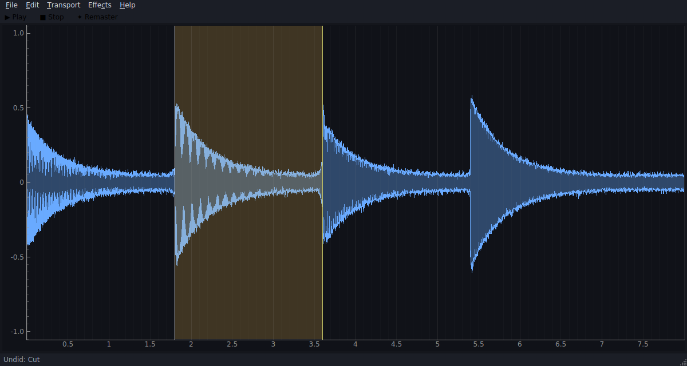

# RVSangeetha

**Cassette restoration and remastering for Carnatic music — voiced for the
Saraswati veena.**

RVSangeetha takes digitised cassette transfers of veena recitals (with
mridangam, ghatam, khanjira accompaniment, and the artist's occasional
singing) and removes the tape's fingerprints — hiss, mains hum, dropouts,
crackle and saturation — while protecting what matters musically: the long
decay of a plucked string, the microtonal shimmer of gamakas, and the attack
of percussion strokes.



## Why a veena-specific tool?

Generic noise reduction is tuned for speech or pop. Cassette veena
recordings fail differently:

- **Hiss sits where the music breathes.** A veena note decays *into* the
  noise floor; a hard gate amputates the tail of every phrase. RVSangeetha's
  spectral gate (modelled on Audacity's Noise Reduction) uses a long release
  (150 ms default) and per-bin smoothing so sustain and gamakas survive.
- **50 Hz hum, not 60.** Indian mains leaks into home and sabha recordings
  at 50 Hz plus strong harmonics. The hum comb defaults to 50 Hz with 8
  harmonics, with a Q high enough (35) not to thin the veena's low register.
- **Percussion is spiky on purpose.** Click detection is statistical (local
  median absolute deviation), so a mridangam *chapu* or khanjira slap —
  which raises the local statistics along with the peak — is never mistaken
  for a dropout.
- **Tape dulls the top.** Self-erasure and azimuth drift roll off the
  sparkle of the veena's attack. A gentle 7.5 kHz shelf (+2.5 dB) and a
  small 3.2 kHz presence lift (which also flatters the artist's voice)
  restore it without hiss coming back — they are applied *after* the gate.

## Features

**Restoration (the main event)**
- ✦ **One-Click Remaster** — the full chain with the veena preset, every
  stage toggleable and adjustable.
- **Noise profile workflow** — select a stretch of pure hiss (lead-in or the
  gap between items), *Effects → Capture Noise Profile*, then reduce. With
  no profile, the quietest half-second is profiled automatically.
- **Noise Reduction** — spectral gating with reduction, sensitivity,
  frequency smoothing, attack/release controls.
- **Hum Removal** — zero-phase notch comb, frequency/harmonics/Q adjustable.
- **Click & Dropout Repair** — MAD-based detection, cubic-spline resynthesis.
- **Declip** — rebuilds flattened peaks from tape or input saturation.
- **Tape Tone EQ** — rumble high-pass, brilliance shelf, presence bell.
- **Normalize / Amplify / Fade** and a transparent soft-knee limiter.

**Editing (the helpers)**
- Waveform display (min/max envelope, fast on full cassette sides), click
  to place the cursor, drag to select, wheel to zoom.
- Cut / Copy / Paste / Delete / Trim / Silence, with undo/redo.
- **Split at Cursor** markers + **Export Split Segments** — mark item
  boundaries of a recital and export each kriti as its own file.
- Playback of file or selection with a moving playhead.
- Export WAV 16/24-bit, FLAC, MP3; export selection only.

## Running on Windows

Requires Python 3.10+ from [python.org](https://www.python.org/downloads/)
(tick *Add python.exe to PATH* during install).

```bat
run_windows.bat          :: creates a venv, installs deps, launches the app
```

To build a standalone `RVSangeetha.exe`:

```bat
build_windows.bat        :: output in dist\RVSangeetha\
```

(The code is pure Python/Qt and also runs on Linux/macOS:
`python -m rvsangeetha`.)

## Suggested workflow

1. Digitise the cassette at 44.1 kHz / 16-bit or better and **File → Open**
   the transfer.
2. Select ~1 s of pure tape hiss and **Capture Noise Profile** (`Ctrl+N`).
3. **One-Click Remaster** (`Ctrl+R`) — audition, undo (`Ctrl+Z`), tweak,
   repeat. Start conservative: 12 dB of hiss reduction is usually plenty;
   more and the veena's tail starts to sound watery.
4. Fix remaining defects locally: select just the damaged spot and run
   Click Repair or Declip on the selection.
5. **Split at Cursor** between items, then **Export Split Segments**.

## Development

```bash
python -m venv .venv && . .venv/bin/activate
pip install -r requirements.txt pytest
python -m pytest tests/         # DSP regression tests on synthetic signals
```

Notes: processing is float32 throughout; undo keeps up to 8 full snapshots
(bounded memory on 45-minute sides). Restoration filters run zero-phase,
which is only possible offline — one of the luxuries of remastering over
live processing.
